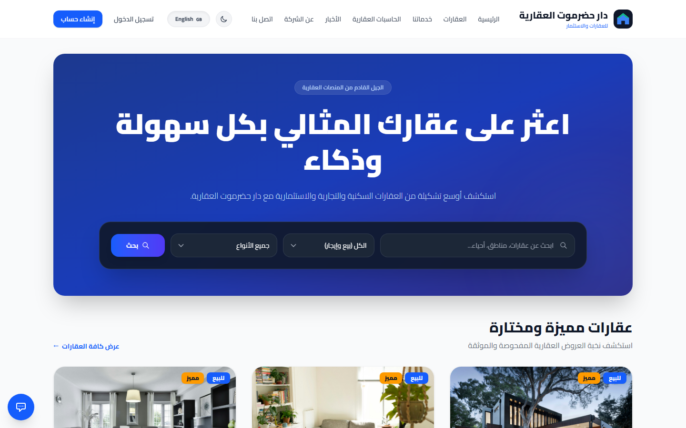

# Novixa Aqar (نوفيكسا عقار)


---

## Smart Real Estate Management Platform — Novixa Aqar

**Novixa Aqar (نوفيكسا عقار)** is a bilingual (Arabic-first), Yemen-focused real estate and property management platform owned by **Novixa** and developed by **AK01REDWAN**. It brings public property listings, tenant/landlord/buyer/seller/contractor self-service, lease and maintenance management, and a role-based administration back office together on a Laravel 13 / Filament 5 foundation.

- 🏠 Property listings, moderation, leases, maintenance requests and bookings in one platform
- 👥 9 role-specific panels: Admin, Staff, Agent, Buyer, Seller, Landlord, Tenant, Contractor, and a public App panel
- 🌐 Arabic-first bilingual UI (AR/EN) with RTL/LTR layout support
- 🧭 AI-assisted investment analysis, interactive 3D property models, and neighbourhood insights on listing pages
- 🛠️ Docker Compose ready for local development and demo deployment

> **Status:** this codebase is verified **READY FOR DEMO** — every core workflow below has been live-tested end-to-end (not just covered by green automated tests). It is **NOT YET CONFIGURED FOR PRODUCTION**; see [Project Status](#project-status) and [`docs/PRODUCTION-DEPLOYMENT.md`](docs/PRODUCTION-DEPLOYMENT.md) before deploying to a real domain.



---

## Features

| Feature | Description |
|---|---|
| **Property Listings** | Create and manage residential and commercial listings with rich media, pricing, availability and moderation workflow. |
| **Public Site** | Property search/browse/detail, owner property submission, buyer property requests, contact forms — bilingual AR/EN. |
| **Tenant & Landlord Management** | Track tenants, landlords, lease agreements, rent schedules and maintenance requests. |
| **Bookings** | Prospective tenants and buyers can book property viewings directly through the platform. |
| **AI Investment Analysis** | Automated investment insights embedded on property detail pages. |
| **3D Property Models** | Interactive Three.js-based 3D viewing on property detail pages. |
| **Neighbourhood Insights** | Demographics, amenities and walkability information per listing. |
| **Portal Sync** | Per-team-scoped listing sync integrations (e.g. Rightmove/Zoopla/OnTheMarket-style portals). |
| **Admin Panel** | Back office powered by Filament 5 with role-based access control via Filament Shield. |
| **Real-time UI** | Livewire 4 driven interactive interfaces. |
| **Multi-auth & Social Login** | Jetstream + Socialstream for first-party and OAuth authentication. |
| **Docker Ready** | One-command local development and demo deployment with Docker Compose. |

---

## Installation

### Prerequisites

- PHP 8.4+ (this repository is developed and tested against PHP 8.4.1+ — see [`docs/PRODUCTION-DEPLOYMENT.md`](docs/PRODUCTION-DEPLOYMENT.md) for the exact toolchain notes)
- Composer 2
- MySQL 8 (default) — PostgreSQL/SQLite are supported by Laravel but not part of the tested demo configuration
- Node.js 20+ & npm (for front-end assets)

### Option 1 — Command-line installer (`setup.sh`)

The quickest way to get started on Linux/macOS, once you have a local copy of this repository:

```bash
chmod +x setup.sh
./setup.sh
```

`setup.sh` copies `.env.example` → `.env`, generates the application key, installs Composer and npm dependencies, runs database migrations and seeds demo data automatically. It also supports a Docker Compose path (`./setup.sh docker`) and a non-interactive CI mode (`./setup.sh standalone --ci`) — run `./setup.sh --help` for details.

### Option 2 — Manual step-by-step

```bash
composer install
cp .env.example .env
php artisan key:generate
# Edit .env with your database credentials, then:
php artisan migrate --seed
npm install && npm run build
php artisan serve
```

### Option 3 — Docker Compose

```bash
docker compose up -d --build
```

This is the deployment path documented and exercised in [`docs/PRODUCTION-DEPLOYMENT.md`](docs/PRODUCTION-DEPLOYMENT.md). The application will be available at `http://localhost:8000` once the containers are healthy.

### Option 4 — Laravel Sail

```bash
./vendor/bin/sail up
```

---

## Project Status

This platform has gone through iterative demo-readiness audits and end-to-end, live-browser QA passes (see `docs/AQAR-DEMO-READINESS-AUDIT.md` and `docs/AQAR-FINAL-END-TO-END-ACCEPTANCE-REPORT.md`). Current status:

- ✅ **READY FOR DEMO** — property management, moderation, lease agreements, public lead-generation forms, search/filter, cross-role authorization boundaries, and media uploads have all been reproduced and verified through real browser interaction, not just an automated test pass.
- ⚠️ **NOT READY FOR PRODUCTION** as-is — deploying to a real domain requires working through the environment/security checklist in [`docs/PRODUCTION-DEPLOYMENT.md`](docs/PRODUCTION-DEPLOYMENT.md) and [`docs/RELEASE-CHECKLIST.md`](docs/RELEASE-CHECKLIST.md) first (production `.env` values, HTTPS/session/cookie configuration, queue/cache drivers, mail, and third-party API keys).
- See [`docs/AQAR_TASKS.md`](docs/AQAR_TASKS.md) and [`docs/AQAR-REMAINING-WORK.md`](docs/AQAR-REMAINING-WORK.md) for the live task list and known open items.

---

## Documentation

- [`docs/PRODUCTION-DEPLOYMENT.md`](docs/PRODUCTION-DEPLOYMENT.md) — production deployment and environment configuration guide
- [`docs/RELEASE-CHECKLIST.md`](docs/RELEASE-CHECKLIST.md) — local vs. production QA checklist
- [`docs/AQAR_PROGRESS.md`](docs/AQAR_PROGRESS.md) / [`docs/AQAR_TASKS.md`](docs/AQAR_TASKS.md) — live project status and task tracking
- [`docs/COMMUNITY_EVENTS.md`](docs/COMMUNITY_EVENTS.md) — community events calendar feature, shown near properties on detail pages
- [`docs/TEST_USERS.md`](docs/TEST_USERS.md) — seeded demo accounts for each role/panel

---

## Contributing

1. **Fork** the repository and create a new branch from `main` (e.g. `feature/my-new-feature`).
2. **Write tests** for any new functionality or bug fix — the project uses PHPUnit via `php artisan test`.
3. **Follow PSR-12** coding standards. Run `./vendor/bin/pint` before committing to auto-fix style issues.
4. **Open a Pull Request** against `main` with a clear description of the change and why it's needed.

For larger changes, please open an issue first to discuss the approach before investing significant time.

---

## License

This project is licensed under the **MIT License** — see the [LICENSE](LICENSE) file for the full text.

Novixa Aqar is a substantially customized, localized and extended derivative of the open-source [Liberu Real Estate](https://github.com/liberu-real-estate/real-estate-laravel) project, originally created by Curtis Delicata and contributors and also distributed under the MIT License. The `LICENSE` file carries both the original and Novixa's copyright notices, as required by the MIT license's attribution term.

**What the MIT license means for you:**

- ✅ **Free to use** — commercially and privately, without paying royalties.
- ✅ **Free to modify** — adapt the code to your exact business needs.
- ✅ **Free to distribute** — share your modifications or bundle the software in your own products.
- ℹ️ **Attribution required** — keep the copyright notice in any copy or substantial portion of the software.

---

## Maintainers & Project Ownership

Project owned by **Novixa** and developed by **AK01REDWAN**.

<!-- End of file -->
