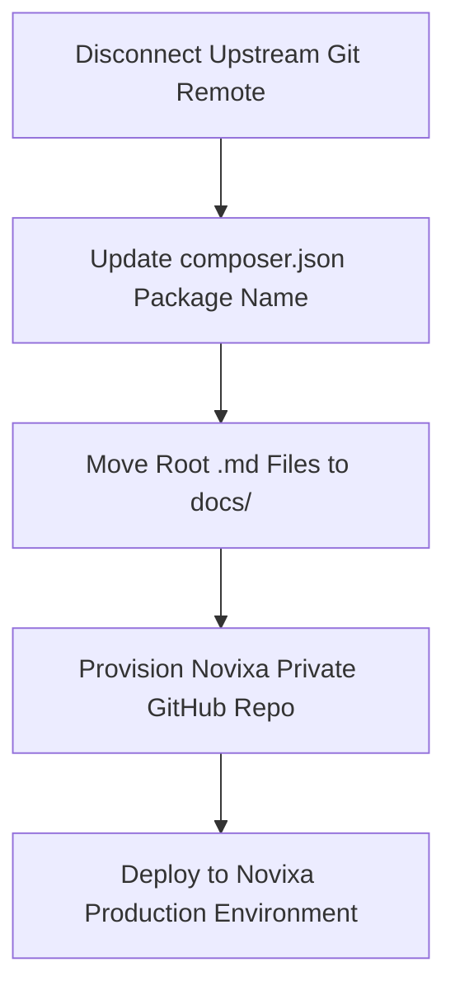

# 01 — Executive Summary Audit Report

**Product**: Aqar (عقاري) — Novixa Private Edition  
**Auditor**: Senior Engineering & Product Review Team  
**Date**: August 13, 2026  
**Repository Branch**: `feature/aqar-productization`  
**Target Repository Ownership**: Novixa  

---

## 1. Executive Summary

This report provides a comprehensive, evidence-based audit evaluating the current state of the **Aqar (عقاري)** real estate web platform to determine its readiness for transition into **Novixa's private product portfolio**, repository separation from the upstream open-source project, branding sign-off, and production deployment.

### Audit Summary Matrix

| Metric | Findings / Status | Verdict |
|---|---|---|
| **Core Functionality** | 18 of 18 Productization Tasks COMPLETED & Verified | **PASS** |
| **Test Suite Quality** | 720 Tests Passing, 2,397 Assertions, 0 Failures, 0 Errors | **PASS** |
| **Security & Middleware** | Auth guards, CSRF protection, Mass assignment protection, Blade escaping verified | **PASS** |
| **Localization & UX** | 100% Arabic RTL layout, Yemeni Rial (YER) currency, Al-Mukalla neighborhood seeders | **PASS** |
| **Git Repository State** | Clean working tree; currently linked to original upstream `liberu-real-estate` remote | **ACTION REQ** |
| **Package Metadata** | `composer.json` currently references `liberu-real-estate/real-estate-laravel` | **ACTION REQ** |
| **Documentation Layout** | 30 legacy Markdown files floating in repository root | **ACTION REQ** |

---

## 2. Master Release & Separation Verdict

### **VERDICT: YELLOW — MOSTLY READY BUT REQUIRED FIXES REMAIN**

#### Justification:
The codebase, database schemas, security controllers, localization engine, and automated test suite (720 passing tests) are in an exceptional state. However, before creating the new private Novixa GitHub repository and deploying to production, four specific administrative and branding fixes must be performed:

1. **Git Remote Disconnection**: Remove upstream remote (`git remote remove origin`) and push to Novixa's private GitHub organization repository.
2. **Composer Metadata Update**: Change package name in [`composer.json`](file:///c:/Users/ak01redwan/Desktop/mywork/aqar-project/aqar/composer.json#L2) from `liberu-real-estate/real-estate-laravel` to `novixa/aqar`.
3. **Documentation Consolidations**: Relocate 30 root `.md` files into organized subdirectories inside [`docs/`](file:///c:/Users/ak01redwan/Desktop/mywork/aqar-project/aqar/docs).
4. **Production Configuration**: Provision production `.env` with Novixa production credentials, SSL certificate, SMTP, and database details.

---

## 3. Key Findings by Domain

### A. Core Platform Architecture
- **Framework**: Laravel 13 running on PHP 8.4+.
- **Frontend Stack**: Blade templates, TailwindCSS v4, Livewire 3/4, Alpine.js, Flowbite, Leaflet maps.
- **Admin & Portals**: Filament v5 multi-panel administration (`/admin`, `/app`, `/tenant`).

### B. Productization & Yemen Localization
- Fully customized for Yemen and Hadramout (Al-Mukalla) real estate markets.
- Currency formatted in Yemeni Rials (`ر.ي` / `YER`).
- WhatsApp direct click-to-chat integration on property listing cards.

### C. Security Posture
- CSRF middleware active across all forms.
- Sensitive models (`Property`, `Lead`, `Buyer`, `RentalApplication`) enforce strict `$fillable` mass-assignment guards.
- Protected routes require explicit `auth` and `verified` middleware guards.

---

## 4. Top Priority Actions

1. **Disconnect Git Remote**: Run `git remote remove origin`.
2. **Create Novixa Repository**: Initialize `https://github.com/novixa/aqar-real-estate.git`.
3. **Execute Production Deployment Checklist**: Follow [`23_FINAL_RELEASE_CHECKLIST.md`](file:///c:/Users/ak01redwan/Desktop/mywork/aqar-project/aqar/docs/audit/23_FINAL_RELEASE_CHECKLIST.md).
