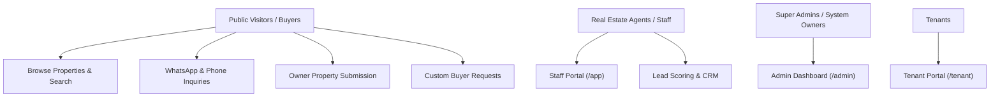

# 02 — Project Overview & Architecture Report

**Product**: Aqar (عقاري) — Novixa Private Edition  
**Framework**: Laravel 13 (PHP 8.4)  
**Database**: MySQL / SQLite (151 Migration Files)  

---

## 1. Product Context & Objectives

**Aqar (عقاري)** is an enterprise-grade real estate management platform tailored for property listings, lead management, owner property submissions, buyer matching, property valuations, interactive map exploration, and multi-panel agency administration.

Customized under the **Novixa** private product line, the platform delivers localized experiences for the Yemeni & Arab real estate market, featuring Arabic RTL layout, Yemeni Rial (`YER` / `ر.ي`) pricing, Al-Mukalla neighborhood cataloging, WhatsApp click-to-contact buttons, and automated lead capture workflows.

---

## 2. Target Audience & Personas

1. **Public Property Seekers**: Search, filter, view 3D models/AR tours, contact agents via WhatsApp or direct calls, request custom properties, and save favorites.
2. **Property Owners**: Submit properties for sale or rent through guided multi-step owner forms pending admin approval.
3. **Real Estate Agents & Staff**: Manage leads, viewing schedules, valuations, contracts, and marketing brochures via the Staff Portal (`/app`).
4. **Platform Administrators**: Manage site settings, roles/permissions (Spatie Permission & Filament Shield), team memberships, and analytics via the Admin Dashboard (`/admin`).

---

## 3. Technology Stack & Key Libraries

| Component | Technology / Library | Description |
|---|---|---|
| **Backend Framework** | Laravel 13.0 | PHP 8.4 core framework |
| **Administration** | Filament v5 | Multi-panel administration (`/admin`, `/app`, `/tenant`) |
| **RBAC / Security** | Spatie Permission & Filament Shield | Role and permission management |
| **Authentication** | Jetstream & Fortify | Auth, 2FA, session security |
| **Frontend Styling** | TailwindCSS v4 & Vanilla CSS | Custom RTL styling, Cairo & Tajawal fonts |
| **Reactivity** | Livewire 3/4 & Alpine.js | Reactive listing filters and wishlist manager |
| **Interactive Maps** | Leaflet.js | Neighborhood boundaries and property map markers |
| **Media Library** | Spatie Laravel MediaLibrary | Image uploads, watermarks, responsive thumbs |
| **Sitemap & SEO** | Spatie Laravel Sitemap | Dynamic OpenGraph, JSON-LD, sitemap generation |

---

## 4. Key Subsystems Overview

1. **Property Catalog & Filters**: Full-text search, price slider (up to 1,000,000,000 YER), bedroom/bathroom/area filters, property types (Apartment, Villa, Land, Commercial, HMO).
2. **Lead & Buyer Management**: Lead capture forms, automated lead scoring (0-100), lead categories (Hot, Warm, Cold), Yemeni phone number normalization (`+967 77x...`).
3. **Owner Submissions**: Multi-step owner listing submission flow with pending approval state.
4. **SEO & Social Sharing**: Dynamic `<title>`, meta descriptions, Facebook OpenGraph tags, Twitter cards, JSON-LD RealEstateListing schema.
