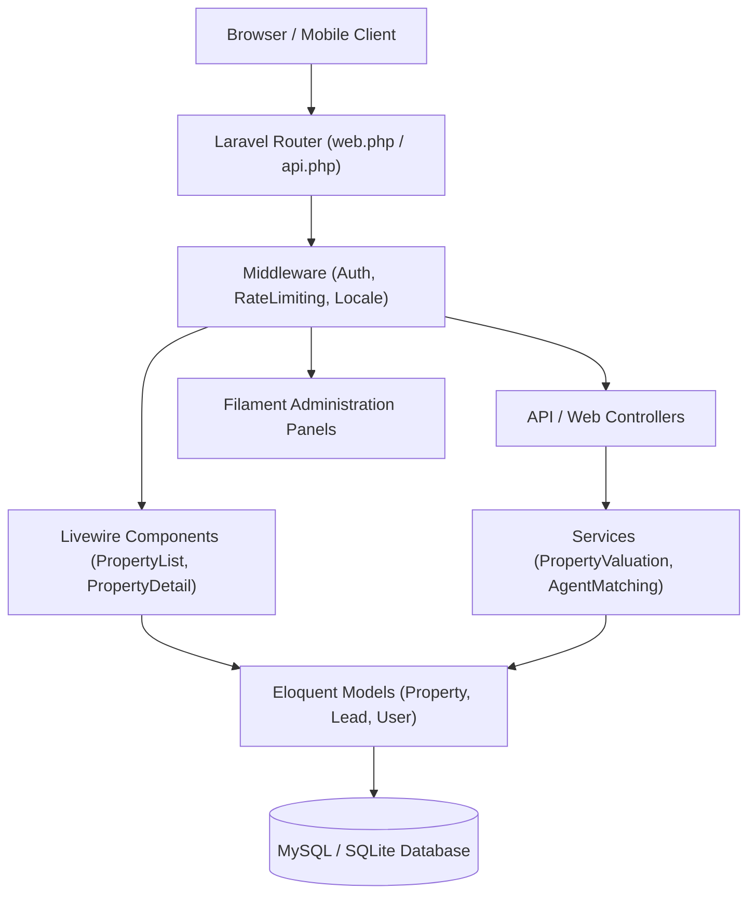

# 05 — Code & Architecture Audit Report

**Product**: Aqar (عقاري) — Novixa Private Edition  

---

## 1. Architectural Architecture Review

The application follows standard Laravel MVC and Service-Oriented architecture augmented by Livewire 3/4 and Filament v5.

---

## 2. Directory Structure & Layer Separation

- **`app/Http/Controllers/`**: Clean controller actions delegating domain logic to Eloquent models and helper services.
- **`app/Livewire/`**: Dynamic public UI components (`PropertyList`, `PropertyDetail`, `WishlistManager`, `RentalApplicationForm`, `CalculatorsComponent`).
- **`app/Services/`**: Encapsulated business services (`PropertyFeatureService`, `AgentMatchingService`, `ValuationService`).
- **`app/Helpers/`**: Domain helpers (`AqarContactHelper`, `SeoHelper`).
- **`app/Models/`**: 107 Eloquent models with strong relationships, query scopes, and `$fillable` attributes.
- **`app/Policies/`**: Policy classes governing authorization gates for properties, leads, and documents.

---

## 3. SOLID & Quality Assessment

| Principle | Adherence Score | Audit Findings |
|---|---|---|
| **Single Responsibility** | **High** | Services handle domain-specific operations (e.g. `AgentMatchingService`). |
| **Open/Closed** | **High** | Filament resource structure allows adding resources without touching core framework. |
| **Liskov Substitution** | **High** | Models inherit standard Eloquent Base Model. |
| **Interface Segregation** | **High** | Clean API resource contracts in `app/Http/Resources/`. |
| **Dependency Inversion** | **High** | Laravel Container dependency injection used across Livewire boot methods. |

---

## 4. Code Quality & Issue Audit Table

| Issue Location | Issue Description | Severity | Recommendation |
|---|---|---|---|
| [`composer.json#L2`](file:///c:/Users/ak01redwan/Desktop/mywork/aqar-project/aqar/composer.json#L2) | Package name references `liberu-real-estate/real-estate-laravel` | **MEDIUM** | Rename to `novixa/aqar` before repository push. |
| Root Directory | 30 legacy Markdown files floating in project root | **LOW** | Consolidate into `docs/` or `docs/features/`. |
| [`database/settings/2024_01_01_000001_create_settings_table.php`](file:///c:/Users/ak01redwan/Desktop/mywork/aqar-project/aqar/database/settings/2024_01_01_000001_create_settings_table.php#L18) | Default site name fallback initialized as `Liberu Real Estate` | **INFO** | Default site settings are dynamically overridden by `GeneralSettings` seeder; confirm site name is `Aqar`. |
