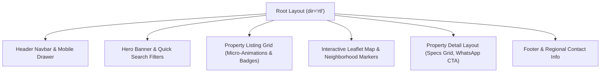

# 09 — UI/UX & Visual Experience Audit Report

**Product**: Aqar (عقاري) — Novixa Private Edition  

---

## 1. Visual & Layout Quality Assessment

The user interface delivers a modern, high-contrast, state-of-the-art visual presentation tailored specifically for the Yemeni and Arabic real estate market.

---

## 2. RTL Symmetry & Typography Rules

- **RTL Support**: `dir="rtl"` explicitly enabled on standard Blade root template ([`resources/views/layouts/app.blade.php`](file:///c:/Users/ak01redwan/Desktop/mywork/aqar-project/aqar/resources/views/layouts/app.blade.php#L6)).
- **Typography Hierarchy**: Loaded Google Fonts (Cairo, Tajawal, Inter) in [`resources/css/app.css`](file:///c:/Users/ak01redwan/Desktop/mywork/aqar-project/aqar/resources/css/app.css).
- **RTL Direction Safety**: CSS utilities avoid fixed `left:`/`right:` positioning where possible, favoring flexbox and start/end logical properties.

---

## 3. UI Component Inventory & Assessment

| Component | View / Template Location | Visual Quality | Micro-Interactions | Accessibility / RTL |
|---|---|---|---|---|
| **Property Card** | [`livewire/property-list.blade.php`](file:///c:/Users/ak01redwan/Desktop/mywork/aqar-project/aqar/resources/views/livewire/property-list.blade.php) | **High** | Hover zoom (`scale-105`), badge overlays | Excellent RTL balance |
| **WhatsApp CTA Button** | [`AqarContactHelper`](file:///c:/Users/ak01redwan/Desktop/mywork/aqar-project/aqar/app/Helpers/AqarContactHelper.php) | **High** | Hover scale (`whatsapp-btn`), brand green (`#25D366`) | Clear icon & tooltips |
| **Wishlist Grid** | [`livewire/wishlist-manager.blade.php`](file:///c:/Users/ak01redwan/Desktop/mywork/aqar-project/aqar/resources/views/livewire/wishlist-manager.blade.php) | **High** | Trash icon hover scale, smooth pagination | Arabic text & YER prices |
| **Mobile Drawer Menu** | [`components/home-navbar.blade.php`](file:///c:/Users/ak01redwan/Desktop/mywork/aqar-project/aqar/resources/views/components/home-navbar.blade.php) | **High** | Smooth drawer toggle, responsive backdrop | Touch friendly |
