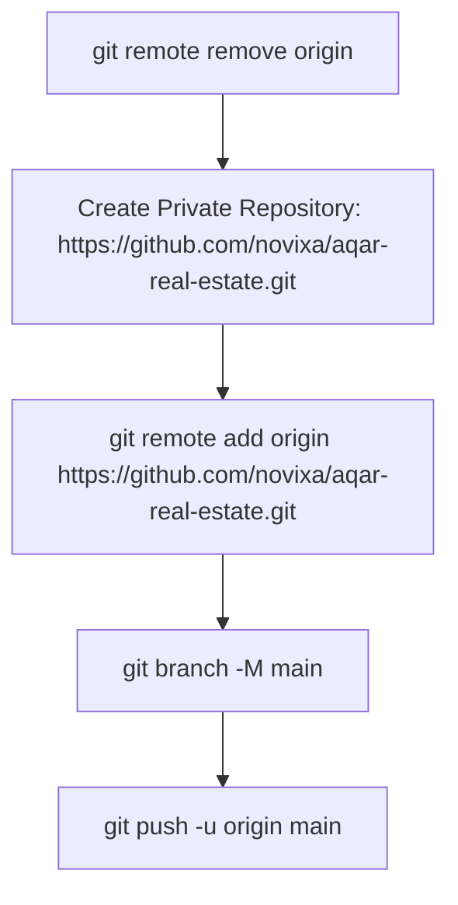

# 14 — Git & Repository Audit Report

**Product**: Aqar (عقاري) — Novixa Private Edition  
**Current Branch**: `feature/aqar-productization`  

---

## 1. Git Repository State Audit

### Key Git Metadata
- **Current HEAD Commit**: `7ea41d4` (`fix(security): refine redirect assertions for protected routes in SecurityReviewTest`).
- **Working Directory**: **Clean** (`git status` reports zero unstaged or untracked changes).
- **Remotes**:
  ```
  origin https://github.com/liberu-real-estate/real-estate-laravel.git (fetch)
  origin https://github.com/liberu-real-estate/real-estate-laravel.git (push)
  ```

---

## 2. Remote & Repository Separation Analysis

### Critical Findings
1. **Upstream Remote Link**: The local repository remains connected to the open-source repository `https://github.com/liberu-real-estate/real-estate-laravel.git`.
2. **Safety Assessment**:
   - **Is the current remote safe?**: No. Pushing directly to `origin` would attempt to push customized Novixa product features to the open-source repository.
   - **Action Required**: The original `origin` remote MUST be removed (`git remote remove origin`) before creating the new Novixa private GitHub repository.

---

## 3. Step-by-Step Repository Transition Plan



1. **Remove Old Remote**:
   ```bash
   git remote remove origin
   ```
2. **Create Novixa Repository**: Create a private GitHub repository under Novixa organization (e.g. `https://github.com/novixa/aqar-real-estate.git`).
3. **Attach New Remote**:
   ```bash
   git remote add origin https://github.com/novixa/aqar-real-estate.git
   ```
4. **Rename & Push Main Branch**:
   ```bash
   git branch -M main
   git push -u origin main
   ```
