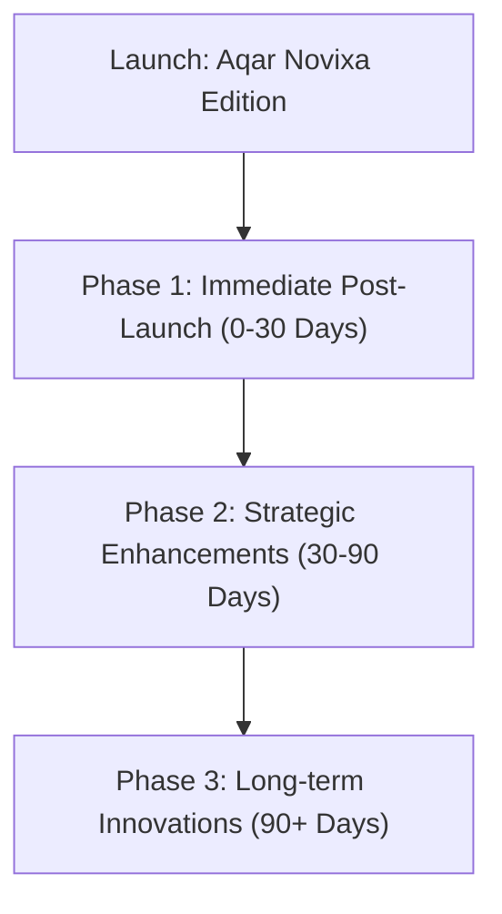

# 22 — Future Improvements & Post-Launch Roadmap Report

**Product**: Aqar (عقاري) — Novixa Private Edition  

---

## 1. Post-Launch Roadmap Categorization

To maintain a clean deployment boundary, future feature enhancements are categorized separately from production deployment blockers.

---

## 2. Roadmap Phase Breakdown

### Phase 1: Immediate Post-Launch (0-30 Days)
- **WhatsApp Webhook Integration**: Automated incoming WhatsApp lead confirmation messages.
- **Analytics Dashboard Expansion**: Visual traffic graphs inside Filament admin panel.
- **Push Notifications**: Web push notifications for favorited property price reductions.

### Phase 2: Strategic Enhancements (30-90 Days)
- **Advanced VR Headset Support**: WebXR integration for direct Oculus/Meta Quest headset property walkthroughs.
- **AI Property Description Generator**: Integrated LLM endpoint for agents to draft Arabic property descriptions automatically.
- **Contract E-Signatures**: Expanded DocuSign API integration for lease agreement e-signing.

### Phase 3: Long-term Innovations (90+ Days)
- **Property Blockchain Ledger**: Expanded smart contract leasing verification.
- **Mobile Native Apps**: React Native / Flutter mobile wrapper consuming V1 REST API endpoints.
