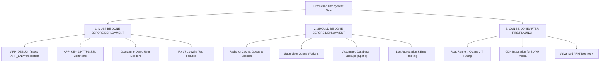

# 33 — Production Configuration Gap Analysis

**Product**: Aqar (عقاري) — Novixa Private Edition  
**Audit Scope**: Production Architecture, Runtime Environment, Infrastructure & Security Gaps  
**Date**: August 15, 2026  
**Auditor**: Independent Senior Release-Gate Team (DevOps & Production Readiness Engineer)  

---

## 1. Executive Summary

This analysis defines the precise technical gap between the current development state and an enterprise-grade production deployment. Findings are categorized into three strict tiers: **Must Have**, **Should Have**, and **Can Defer**.

---

## 2. Gap Classification Tiers

---

## 3. Detailed Gap Matrix

### A. MUST BE DONE BEFORE DEPLOYMENT (Strict Blockers)

| Gap ID | Component / Area | Current State | Required Production State | Impact if Ignored |
|---|---|---|---|---|
| **GAP-01** | `APP_ENV` & `APP_DEBUG` | `local` / `true` in development | `production` / `false` | **CRITICAL**: Exposes stack traces, database schema, and SQL queries to visitors on 500 errors. |
| **GAP-02** | `APP_KEY` & `SESSION_SECURE_COOKIE` | Unset in examples; `false` | Unique 32-byte key; `true` | **CRITICAL**: Insecure cookies susceptible to interception over plain HTTP. |
| **GAP-03** | User Seeders & Default Accounts | `UserSeeder` creates `admin@example.com` (`password`) | Separate into `ProductionDatabaseSeeder` that only creates system roles/permissions and prompts for a unique admin. | **CRITICAL**: Known backdoor super_admin account on production. |
| **GAP-04** | Livewire Test Regressions | 17 tests failing in test suite | 100% passing automated test suite (0 failures) | **HIGH**: Potential unhandled edge cases in property submission and live tour modals. |
| **GAP-05** | Production Domain & SSL | `http://localhost` | Fully qualified domain with TLS 1.3 certificate (e.g. `https://aqar.novixa.ye`) | **CRITICAL**: Browser security warnings; broken OAuth callbacks and cookies. |
| **GAP-06** | Platform PHP Constraint | `"php": "^8.5"` in `composer.json` | `"php": "^8.4\|^8.5"` | **HIGH**: `composer install` will fail on standard PHP 8.4 servers. |

---

### B. SHOULD BE DONE BEFORE DEPLOYMENT (High-Priority Operational Readiness)

| Gap ID | Component / Area | Current State | Recommended Production State | Operational Rationale |
|---|---|---|---|---|
| **GAP-07** | Queue Driver & Background Workers | `QUEUE_CONNECTION=sync` | `QUEUE_CONNECTION=redis` with Supervisor daemon | Synchronous queues block HTTP requests when sending emails, generating PDFs, or processing media uploads. |
| **GAP-08** | Cache & Session Storage | `CACHE_DRIVER=file`, `SESSION_DRIVER=file` | `redis` or `database` | Prevents disk I/O bottlenecks and session loss across clustered web containers. |
| **GAP-09** | Production Mail Gateway | `MAIL_MAILER=smtp` (`mailpit`) | Production SMTP / Transactional API (Postmark, SES, Mailgun) | Ensures viewing confirmations, buyer match alerts, and lead notifications actually reach users. |
| **GAP-10** | Automated Backups | Manual file dumps | `spatie/laravel-backup` scheduled daily with off-site S3/GCS replication | Prevents catastrophic data loss in the event of server failure. |
| **GAP-11** | Error Tracking & Sentry | Log file only (`storage/logs/laravel.log`) | Sentry / Bugsnag exception monitoring | Provides real-time alerting for runtime exceptions before users report them. |
| **GAP-12** | Database Optimization & Pooling | Direct MySQL connections | MySQL 8.0+ tuned buffers (`innodb_buffer_pool_size`), indexes verified | Prevents slow queries during peak property search traffic. |

---

### C. CAN BE DONE AFTER FIRST LAUNCH (Post-Launch Enhancements)

| Gap ID | Component / Area | Description | Target Timing |
|---|---|---|---|
| **GAP-13** | Octane / RoadRunner JIT Acceleration | High-speed in-memory stateful server execution. | Phase 2 Optimization (30–60 days post-launch) |
| **GAP-14** | Cloudflare / AWS CloudFront CDN | Edge caching for 3D GLB models, virtual tours, and property gallery images. | Phase 2 Optimization |
| **GAP-15** | AI Valuation Fine-Tuning | Real-time neural valuation weights trained on Yemeni market sales history. | Iterative update based on collected data |
| **GAP-16** | SMS Gateway Integration | Local Yemeni SMS provider (Yemen Mobile, You) for phone OTP verification. | Next release milestone |
