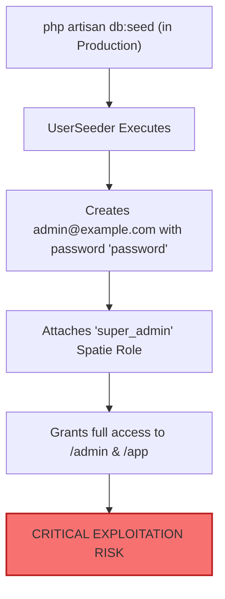

# 35 — Administrative & Default Account Security Audit

**Product**: Aqar (عقاري) — Novixa Private Edition  
**Audit Purpose**: Security Assessment of Privileged Roles, Default Passwords & Admin Creation Workflows  
**Date**: August 15, 2026  
**Auditor**: Independent Senior Release-Gate Team (Security Auditor & IAM Specialist)  

---

## 1. Executive Summary

This audit examines all default user accounts, factories, seeders, role assignments, and privileged administration paths in the system to verify whether any hardcoded, known, or insecure credentials could persist into production.

---

## 2. Hardcoded Privileged Accounts Vulnerability Analysis

### Threat Vector:
[`database/seeders/UserSeeder.php`](file:///c:/Users/ak01redwan/Desktop/mywork/aqar-project/aqar/database/seeders/UserSeeder.php#L21-L59) contains executable code that creates 8 accounts with the globally known password `'password'`:

| Email | Assigned Role | Permissions Level | Risk Level |
|---|---|---|---|
| `admin@example.com` | `super_admin` | Full system access, all panels, all tenant records | **CRITICAL (10/10)** |
| `staff@example.com` | `staff` | Operational panel, all CRM records, internal documents | **HIGH (8/10)** |
| `agent@example.com` | `agent` | Listing management, viewing schedules, buyer matching | **HIGH (7/10)** |
| `landlord@example.com` | `landlord` | Property portfolio, lease agreements, payout info | **MEDIUM (5/10)** |
| `tenant@example.com` | `tenant` | Tenant applications, lease documents | **MEDIUM (5/10)** |
| `contractor@example.com`| `contractor`| Work orders, quotes, invoice submissions | **MEDIUM (5/10)** |
| `buyer@example.com` | `buyer` | Property requests, financial profile | **LOW (4/10)** |
| `seller@example.com` | `seller` | Property submissions, valuation requests | **LOW (4/10)** |



---

## 3. Production Admin Provisioning Standard

To ensure production environments are secure by default:

1. **De-register `UserSeeder` from `DatabaseSeeder`**:
   Remove `UserSeeder::class` from default production seeding.
2. **Implement Interactive CLI Admin Creation**:
   Utilize Filament's native secure creation command or a custom Artisan command:
   ```bash
   php artisan make:filament-user
   ```
   This command interactively prompts the administrator for:
   - Admin Name
   - Admin Email
   - Strong Password (hidden in terminal, hashed via Argon2id / Bcrypt)
3. **Enforce Two-Factor Authentication (2FA)**:
   Jetstream and Fortify 2FA features are present in the codebase. 2FA should be enforced for all `super_admin` and `staff` roles accessing `/admin`.
4. **Brute Force Throttling**:
   Login endpoints are protected via Fortify rate limiters (defaulting to 5 attempts per minute with exponential backoff).

---

## 4. Remediation Checklist

- [ ] Quarantine `UserSeeder.php` to development/staging only.
- [ ] Ensure `DatabaseSeeder.php` does not seed default user accounts when `APP_ENV=production`.
- [ ] Document the initial super-admin creation process in `docs/deployment/PRODUCTION_RUNBOOK.md`.
- [ ] Enforce strong password validation rules in production (`Password::min(10)->letters()->mixedCase()->numbers()->symbols()->uncompromised()`).
